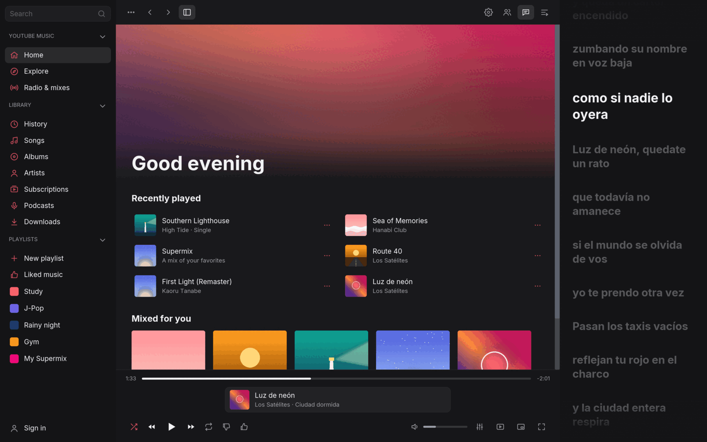
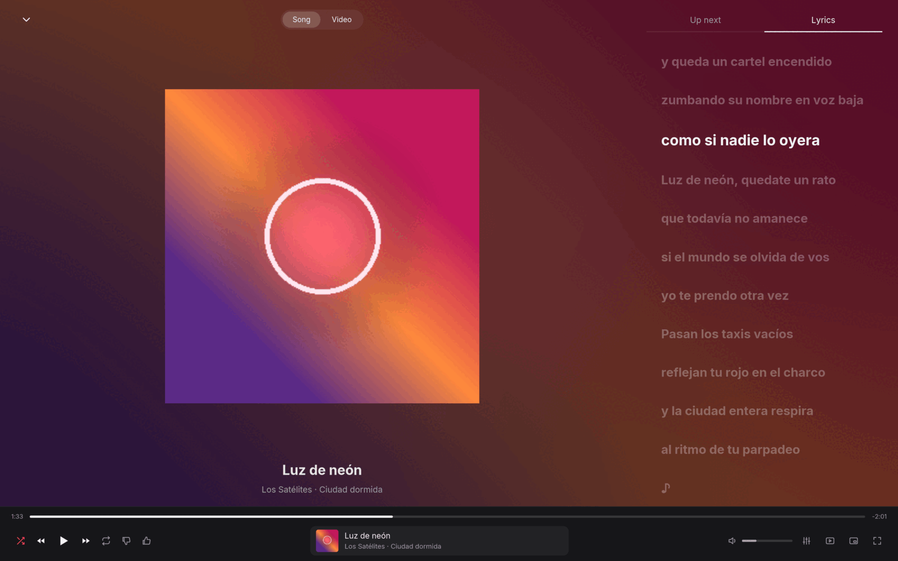
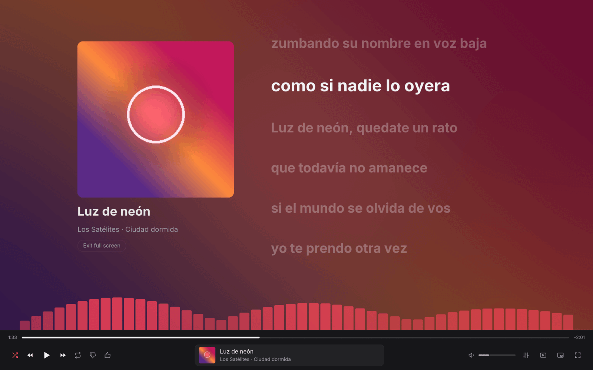

<div align="center">


# Encore

[](https://github.com/YX14ng/Encore/releases/latest)
[](https://github.com/YX14ng/Encore/blob/main/LICENSE)
[](https://github.com/YX14ng/Encore/actions/workflows/release.yml)
[](https://github.com/YX14ng/Encore/releases/)



</div>

**Encore** is a desktop player for YouTube Music, written in Rust with [iced](https://iced.rs).
It looks like Cider, does what Pear Desktop does, and adds what a desktop player should have.

- **Native app**: no browser inside, fast with playlists of thousands of songs
- **Synced lyrics** you can scroll and click to jump, with **romanization** for Japanese, Korean
  and Chinese
- **The music video** beside the lyrics, on a now playing page that slides up like Pear's
- **True random shuffle**, made by Encore and not YouTube, so your usual songs do not always come
  first
- **Sound**: 10-band equalizer, compressor, volume normalization, crossfade, gapless playback,
  skipping silence, playback speed and sound output picker
- **Your library**: sign in to see your playlists, likes, mixes and history; make and edit
  playlists, like and dislike songs, give playlists your own cover
- **YouTube Music Premium** quality (Opus around 256 kbit/s) and no ads
- **Plugins**: Discord status, Last.fm scrobbling, desktop notifications, SponsorBlock, skip
  disliked songs, visualizer, romanized lyrics
- **Listen together** with friends, over the internet or through Discord
- **Offline downloads**, mini player, media keys (MPRIS), themes and an accent color taken from
  the cover
- **15 languages**: English, 简体中文, 繁體中文, हिन्दी, Español, العربية, Français, বাংলা,
  Português (Brasil), Русский, Bahasa Indonesia, Deutsch, Italiano, 日本語 and 한국어

> [!IMPORTANT]
>
> ⚠️ Disclaimer
>
> **No Affiliation**: Encore is an independent project. It is not affiliated with, endorsed by,
> sponsored by or in any way officially connected with Google LLC, YouTube or any of their
> subsidiaries or affiliates.
>
> **Trademarks**: "YouTube", "YouTube Music" and their logos are trademarks of Google LLC. They
> are used here only to describe what Encore works with.
>
> **Limitation of Liability**: Encore downloads songs with yt-dlp and, when you are signed in,
> with your session. yt-dlp warns that accounts used this way can get blocked for a while. You
> use Encore at your own risk; the authors are not responsible for any consequence to your
> account.

## Content

- [Download](#download)
  - [Arch Linux](#arch-linux)
  - [Linux Mint and Ubuntu](#linux-mint-and-ubuntu)
  - [Fedora](#fedora)
  - [Flatpak](#flatpak)
  - [Other Linux](#other-linux)
  - [Windows](#windows)
- [Screenshots](#screenshots)
- [Translation](#translation)
- [Themes](#themes)
- [Dev](#dev)
- [Build](#build)
- [Tests](#tests)
- [License](#license)
- [FAQ](#faq)

## Download

Get the latest version from the [releases page](https://github.com/YX14ng/Encore/releases/latest).

Encore downloads songs with [yt-dlp](https://github.com/yt-dlp/yt-dlp), which YouTube changes
often break: keep it up to date. It needs a JavaScript runtime for YouTube's challenges
([deno](https://deno.com)), and [mpv](https://mpv.io) and [ffmpeg](https://ffmpeg.org). The
Windows build includes all of them; on Linux they come from your distribution.

### Arch Linux

Download `encore-ytm-<version>-1-x86_64.pkg.tar.zst` from the releases page and install it:

```bash
sudo pacman -U ./encore-ytm-*-x86_64.pkg.tar.zst
```

Or build it yourself from the [`PKGBUILD`](packaging/arch/PKGBUILD) in this repository, which
also works if a ready-made package stops opening after Arch updates libmpv or WebKitGTK:

```bash
git clone https://github.com/YX14ng/Encore
cd Encore/packaging/arch
makepkg -si
```

### Linux Mint and Ubuntu

Download `encore-ytm_<version>_amd64.deb` from the releases page (built on Ubuntu 24.04, the base
of Linux Mint 22) and install it with a recent yt-dlp and deno, since the ones in the
distribution are too old:

```bash
sudo apt install ./encore-ytm_*_amd64.deb
sudo curl -L https://github.com/yt-dlp/yt-dlp/releases/latest/download/yt-dlp -o /usr/local/bin/yt-dlp
sudo chmod a+rx /usr/local/bin/yt-dlp
curl -fsSL https://deno.land/install.sh | sh
```

### Fedora

Download `encore-ytm-<version>.x86_64.rpm` from the releases page:

```bash
sudo dnf install ./encore-ytm-*.x86_64.rpm
```

### Flatpak

A Flatpak for Flathub is on its way.

### Other Linux

Download `encore-<version>-x86_64-linux.tar.gz`, unpack it and run `encore`. It needs libmpv,
WebKitGTK 4.1, GTK 3 and libsoup 3, plus yt-dlp, deno and ffmpeg.

### Windows

Download `encore-<version>-x86_64-windows-setup.exe` from the releases page and run it. It
installs Encore for your user only (no administrator rights), with yt-dlp, deno, ffmpeg and
libmpv included. If you prefer not to install it, unpack `encore-<version>-x86_64-windows.zip`
anywhere and run `encore.exe`.

It needs 64-bit Windows 10 or 11. The sign-in window uses the WebView2 Runtime, which Windows 11
and an up-to-date Windows 10 already have. Encore is not signed, so the first time SmartScreen
may say "Windows protected your PC": choose **More info → Run anyway**.

## Screenshots

<div align="center">





</div>

How each feature works, where Encore keeps its files and what it asks YouTube for:
[docs/FEATURES.md](docs/FEATURES.md).

## Translation

The interface texts are in [`locales/`](locales/), one file per part of the app with every
language side by side. To add a language, add its texts to every file and its entry to
[`src/i18n.rs`](src/i18n.rs); a test checks that every text exists in every language with the same
placeholders.

## Themes

Settings → Appearance has built-in themes, an accent color taken from the cover, and custom themes
from JSON files in `~/.config/encore/themes/`.

## Dev

```bash
git clone https://github.com/YX14ng/Encore
cd Encore
cargo run
```

Building needs Rust (2024 edition), pkg-config and the development files of libmpv, WebKitGTK 4.1,
GTK 3 and libsoup 3. On Arch: `sudo pacman -S mpv webkit2gtk-4.1 gtk3 libsoup3`.

On Windows, building needs Rust with the MSVC tools and libmpv's DLL with an import library
(`mpv.lib`); the `windows` job of [`.github/workflows/release.yml`](.github/workflows/release.yml)
shows each step.

The design notes of each phase are in [`docs/superpowers/specs/`](docs/superpowers/specs/).

## Build

```bash
cargo build --release
```

The binary is `target/release/encore`. The Japanese dictionary for romanized lyrics is downloaded
once while building and embedded in it. The packages of each release are built by
[`.github/workflows/release.yml`](.github/workflows/release.yml) when a version tag is pushed;
the Arch package is in [`packaging/arch/`](packaging/arch/).

## Tests

```bash
scripts/check.sh
```

It formats, lints with Clippy and runs the tests. The tests that touch YouTube or your account are
ignored by default.

## License

GPL-3.0-or-later © YX14ng. See [LICENSE](LICENSE); the fonts, the Japanese dictionary and the
libraries Encore uses keep their own licenses, listed in [THIRD_PARTY.md](THIRD_PARTY.md).

## FAQ

### Why does a song take a few seconds to start?

Encore downloads each song before playing it. The next two songs of the queue are downloaded
ahead, so the wait only shows when you jump to a song that is not queued. Signed in with Premium
it takes about three seconds; signed out, YouTube puts an ad before the song and yt-dlp waits
for it, about six seconds more.

### How do I update?

Each time it starts, Encore asks GitHub whether there is a newer version (one request, nothing
about you goes with it). If there is, a banner offers to update: Encore downloads the package for
your system, checks its SHA-256 and installs it, asking for your password, then offers to restart.
On Windows it runs the installer. With the `.tar.gz` or the Windows `.zip` it opens the release
page instead. Settings → About turns the check off or runs it now.

### How do I sign in?

Account → Sign in opens a small window where you sign in to Google. The session belongs to
Encore alone: Encore keeps it alive while it is open, and when YouTube drops it, Encore signs in
again by itself, with no window, from the Google sign-in it keeps. It only asks you again when
Google wants your password.
